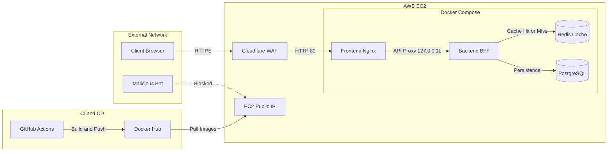
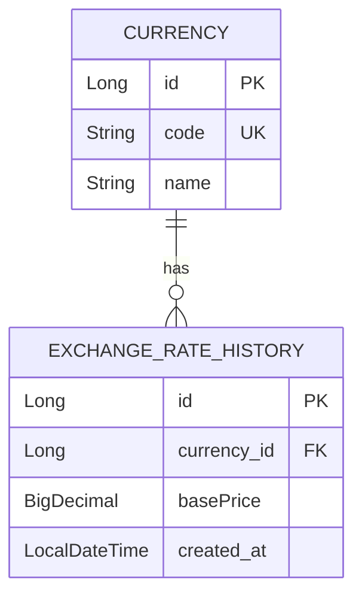

# 📈 ExchangeViewer - 실시간 환율 모니터링 대시보드

실시간 환율 데이터를 수집하고 시각화하는 대시보드 웹 애플리케이션입니다. 
Cloudflare WAF와 Nginx를 활용한 IP 접근 차단 방어선이 구축되어 있으며, 프론트엔드 렌더링 부하를 줄이기 위한 BFF(Backend-For-Frontend) 아키텍처로 설계되었습니다.

🔗 **서비스 링크:** [https://exchangeviewer.shop](https://exchangeviewer.shop)

---

## 🛠 Tech Stack

* **Backend:** Java 25, Spring Boot 4.1.1, Jackson 3.x
* **Frontend:** React, Nginx (Docker 내장 리버스 프록시)
* **Database & Cache:** PostgreSQL, Redis (Spring Data Redis)
* **Infra & CI/CD:** AWS EC2, Docker Compose, Cloudflare (WAF/CDN), GitHub Actions, Docker Hub

---

## 📐 System Architecture

전체 시스템 구성도 및 CI/CD 배포 파이프라인입니다.



---

## 🗄️ Database ERD

환율 데이터의 부동소수점 오차를 방지하기 위해 `BigDecimal`을 사용하고, 시계열 조회를 최적화한 데이터베이스 모델링입니다.



---

## 🚀 Getting Started

로컬 환경에서 프로젝트를 실행하는 방법입니다.

### Prerequisites
* Docker 및 Docker Compose
* Java 25 (로컬 빌드 시)

### Run with Docker Compose
```bash
# 저장소 클론
$ git clone https://github.com/Jingood/ExchangeViewer.git
$ cd ExchangeViewer

# 환경 변수 설정 (.env 파일 구성)
$ cp .env.example .env

# 도커 컴포즈 실행 (백엔드, 프론트엔드, DB, Redis 일괄 실행)
$ docker compose up -d
```

* **프론트엔드:** `http://localhost`
* **백엔드 API:** `http://localhost/api`
* **Swagger UI:** `http://localhost/swagger-ui/index.html`
